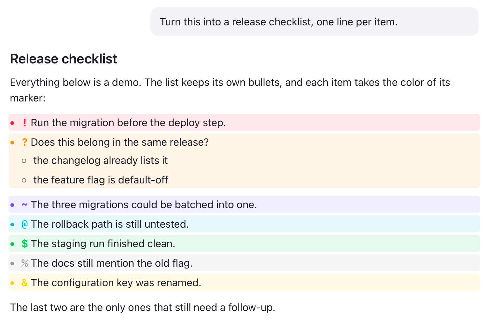
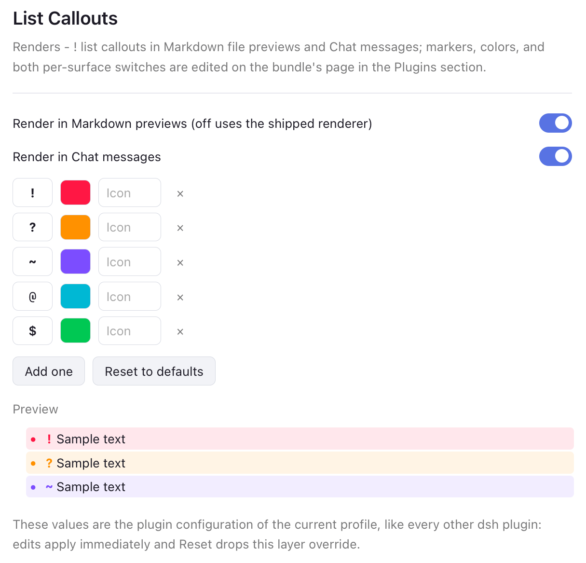
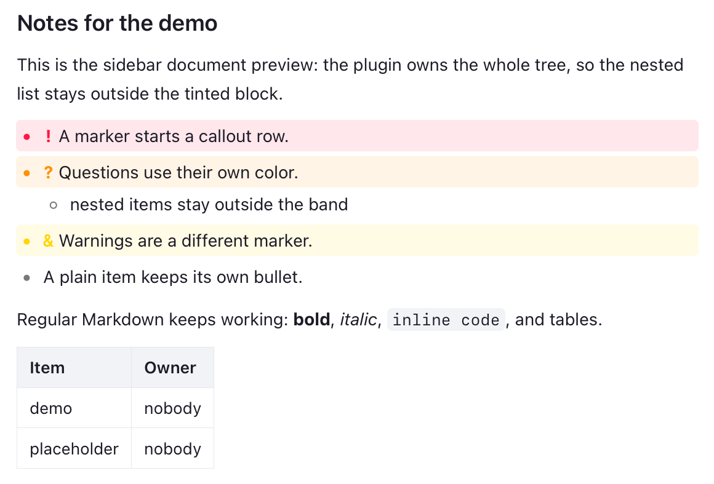

# List Callouts

[English](README.md) | 中文

在 DSH 的 Markdown 文件预览**以及**聊天消息里渲染**列表批注（list callouts）**：列表项开头的第一个字符若是配置过的标记字符，整行就变成一个带底色、带颜色的批注块。

本项目是 [mgmeyers/obsidian-list-callouts](https://github.com/mgmeyers/obsidian-list-callouts)（GPL-3.0）向 DSH Web UI 的移植。Obsidian 插件的阅读视图部分 —— `registerMarkdownPostProcessor` 那一遍 DOM 后处理加上 `styles.css` —— 被重写成 markdown-it 变换 + 作用域 CSS；它的 CodeMirror 实时预览部分在 DSH 没有对应物，因为 DSH 的文件预览是只读的。

## 截图

下面三张是**占位内容的示意图**——聊天渲染、bundle 的配置页（侧边栏 → 插件）、侧边栏文档预览。
它们是用插件自己的样式表构造渲染的，不是从会话里截的。

聊天里列表保留自己的圆点，圆点和标记字符都取批注自身的颜色，嵌套列表落在底色带内：







## 安装

这是一个自包含的 DSH bundle：Host 半（`index.js`）、Browser 半（`client.js`，内嵌 markdown-it）、loader patch、多语言元数据和一个图标。把目录装进 profile：

```sh
npm install                       # Host 半依赖 @deepseek-ai/schemastery
# 在 DSH 的会话 / profile shell 里
plugin_manager install_bundle /path/to/dsh-list-callouts
```

`client.js` 是发布产物，直接改它即可 —— 没有构建步骤，渲染代码都在它的 `//#region` 段里。Host 半（`index.js`）唯一那个运行时依赖需要在本目录装好：profile 用的是目录链接，`pnpm` 不会替你装它。`node_modules` 已 gitignore，`package-lock.json` 已提交。

## 目录结构

| 路径 | 作用 |
|---|---|
| `index.js` | Host 半：`Config` schema（设置页编辑的那个命名空间）以及首帧用的 `__DSH_LIST_CALLOUTS_CONFIG__` 投影 |
| `client.js` | Browser 半：文档预览渲染器、聊天装饰器、CSS |
| `cordis.patch.yml` | 插入本 bundle 的 loader 行 |
| `locale/{en,zh}.json` | 插件管理里的标题/描述 |
| `icon.svg` | 插件图标 |

## 语法

```markdown
- ! 重要
- ? 疑问
- ~ 想法
- @ 备注
- $ 成功
- % 中性
- & 提醒
```

任何列表项都适用：有序列表、嵌套列表、引用块里的列表、任务项。聊天消息、推理文本、会话里渲染的任何 Markdown 都会套用同样的装饰。

```markdown
- [ ] ! 既是任务项又是批注
- ! 父级批注
  - 嵌套项落在底色块之外
```

## 两条渲染路径

| 表面 | 机制 | 还原度 |
|---|---|---|
| 侧边栏文件预览 | 插件注册**自己的** Markdown 文档渲染器，因此整棵树都由它负责 | 完整：带底色 wrapper、嵌套列表不染色、标记可以用图标字形 |
| 聊天 | 常驻装饰器监听已渲染的会话 Markdown：class/属性/自定义变量立即写入，只有等文本稳定 350ms 后才把标记字符切成带样式的 span | 底色覆盖整条列表项（含嵌套项）；气泡自己的 `li` 从不被移动或替换，所以流式更新和虚拟化卸载都安全 |

两侧都保留列表自己的项目符号 —— 聊天里用内置的 `li::marker` 规则，预览里用默认 disc —— 并把底色带向左延伸把它包进去，和 Obsidian 插件一致；任务项显示复选框而不是圆点。

两侧的项目符号都取批注自身的颜色（`li::marker`），所以一行看起来是 `• ! 文本`，圆点、字形、底色同色。

聊天里标记字符没法原地着色（`::first-letter` 在这类列表项上不生效），所以装饰器只在文本稳定 350ms 后把它切成 `<span class="lc-chat-marker">`。原文本节点留在原位 —— 不移动、不换父节点 —— 因此 React 自己的文本更新和卸载仍然合法；一旦 React 重写文本，切分就会被回滚，并在下一次稳定后重新套用。

聊天路径刻意从不改变父节点或替换节点：那段 DOM 属于内置渲染器，它还要流式写 token、卸载虚拟化的行，结构性改动会破坏它的协调（reconciliation）。不想动聊天就在设置页把「在聊天消息中渲染」关掉。

## 接入方式

插件通过 `ctx.documentPreviews` 在 `extension` 优先级带注册**自己的 Markdown 文档渲染器**，所以 `.md` / `.markdown` 文件会带 list-callout 支持打开。内置渲染器仍然注册着：预览工具栏的下拉里两个都在，任何单个文件都能切回内置渲染器。

把 `defaultViewer` 设为 `builtin`（见下）可以让内置渲染器排在前面，"List Callouts" 变成下拉里的可选项。

## 设置

**侧边栏 → 插件 → List Callouts 这个 bundle → 配置区**：标记列表就在 bundle 自己的页面上编辑，和 DSH 自带 bundle 放配置的位置一样（`plugins.bundle.config`）。不用碰任何配置文件：

- 两个开关：**在 Markdown 预览中渲染**（关闭后 `.md` 交还内置渲染器）与**在聊天消息中渲染** —— 两个表面各自独立控制；
- 增删标记：字符（≤ 4 个码元、不含空格）、取色器、可选图标字形；
- 实时预览用真实的批注样式渲染当前列表；
- 每次被接受的修改立刻作用到两个表面 —— 已打开的文档会重渲染，已经渲染好的聊天行会重新装饰；
- **恢复默认**会删掉覆盖值，回落到插件配置。

页面通过插件自己的 Host `Config`（`obsidian-list-callouts` 命名空间）写入：值由 schema 校验，并持久化到当前 profile 的配置层，和每个自带设置页的插件完全一样。Host 侧把这些字段声明成 `.volatile()`，所以被接受的修改无需重载就能到达已打开的文档和聊天装饰器；**恢复默认**会删掉这一层覆盖值。

注入的默认值（profile patch 里那一行的 `config`）只用于首帧，等 settings 镜像应答后就不再使用。早期版本留在浏览器本地的覆盖值（`localStorage['dsh.list-callouts.callouts.v1']`）会一次性迁移进 Host 配置，然后删除。

## 配置项

在 profile 的 `cordis.patch.yml` 里给同名的行加覆盖：

```yaml
- id: obsidian-list-callouts
  config:
    defaultViewer: callouts      # callouts | builtin（侧边栏 .md 预览）
    chatCallouts: true           # 是否装饰聊天消息
    markdownCallouts: true       # 是否接管 .md 预览渲染
    opacityLight: 0.1            # 亮色模式底色透明度，0–1
    opacityDark: 0.15            # 暗色模式底色透明度，0–1
    callouts:
      - { char: '!', color: '255, 23, 68' }
      - { char: '?', color: '255, 145, 0' }
      - { char: '★', color: '255, 214, 0', icon: '★' }
```

- `callouts[].char` —— 标记字符（≤ 4 个码元，不含空格）。
- `callouts[].color` —— `r, g, b`（0–255），同时用于标记字形和底色。
- `callouts[].icon` —— 可选，代替 `char` 显示的字形（emoji 也可以）。
- `opacityLight` / `opacityDark` —— 底色透明度，0–1。
- `defaultViewer` —— `.md` 标签页先用哪个渲染器；另一个仍可在预览工具栏的下拉里选到。
- `chatCallouts` / `markdownCallouts` —— 两个表面的开关，对应设置页里的两个开关。

## 渲染覆盖范围

已支持：标题、段落、强调、嵌套有序/无序列表、任务列表、表格、引用、围栏代码块、行内代码、链接、图片（本地文件走鉴权文件路由，远程 URL 原样保留）、`---` 分隔线，以及开头的 YAML frontmatter（渲染成键值框）。

未覆盖（内置渲染器仍有）：语法高亮、KaTeX 公式、脚注、源码行锚点。Markdown 链接与图片的聚焦交互是本插件自己的，不是内置组件那套。

## 许可

GPL-3.0，继承自本项目所移植的上游插件（见 `LICENSE`）。

内置第三方代码：[markdown-it](https://github.com/markdown-it/markdown-it) 14.1.0，MIT，嵌在 `client.js` 里。
